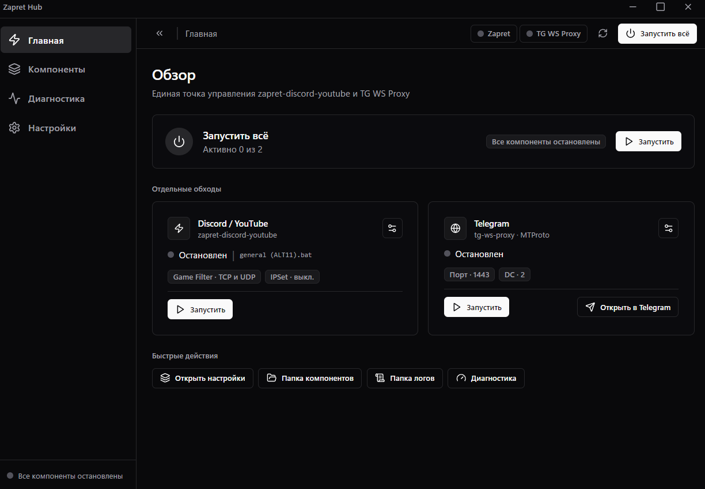

<div align="center">

# Zapret Hub

**Единый пульт управления обходом блокировок**

Одно окно вместо десятка `.bat`-файлов: запуск, остановка, настройка,
обновление и **автоподбор рабочей стратегии**.




</div>

---

Единый графический интерфейс (**Electron + React + TypeScript**) для управления
[**zapret-discord-youtube**](https://github.com/Flowseal/zapret-discord-youtube) и
[**TG WS Proxy**](https://github.com/Flowseal/tg-ws-proxy).

> [!NOTE]
> Версия **1.0.2** — переписанный движок. Прежняя программа была на Python +
> PySide6; теперь то же самое окно работает на Electron. Разделы, настройки и
> логика обхода перенесены один в один, интерфейс перерисован заново.

Оба «запрета» запускаются **дочерними процессами нашего приложения** — мы знаем их PID,
перехватываем вывод в собственный журнал, корректно останавливаем и настраиваем из одного окна.
Компоненты можно обновлять прямо из программы (GitHub Releases), пользовательские списки
и настройки при обновлении сохраняются.

> [!IMPORTANT]
> **Zapret Hub — только оболочка.** Вся логика обхода блокировок принадлежит авторам
> исходных проектов. Мы не модифицируем их код: стратегии запускаются «как есть»
> (`.bat` → `winws.exe`), TgWsProxy запускается с `--portable`. Своё — только интерфейс,
> управление процессами, автозапуск и сборщик IP по ASN.

| Компонент | Автор | Источник |
|---|---|---|
| zapret-discord-youtube | [Flowseal](https://github.com/Flowseal) | github.com/Flowseal/zapret-discord-youtube |
| tg-ws-proxy | [Flowseal](https://github.com/Flowseal) | github.com/Flowseal/tg-ws-proxy |
| данные IP по ASN | RIPE NCC | stat.ripe.net |

```
Telegram Desktop ──► TG WS Proxy (MTProto, 127.0.0.1:1443) ──► WebSocket ──► Telegram DC
Discord / YouTube ─► winws.exe (WinDivert, стратегия из .bat) ──► обход DPI
```

---

## ✨ Возможности

| | |
|:---|:---|
| 🎛 **Мастер-кнопка** | Одна кнопка в верхней полосе запускает и гасит оба обхода сразу. Отдельные карточки — по одной на каждый обход, со плашками ключевых настроек и временем работы |
| 🔬 **Автоподбор стратегии** | По очереди запускает все `general*.bat`, измеряет HTTP/1.1, TLS 1.2, TLS 1.3 и ping по списку целей, ранжирует и **сама применяет лучшую** — даже если прогон остановили вручную |
| 📊 **График каждой проверки** | Отдельный отрезок на каждый ответ: зелёный — быстро, жёлтый — медленно, **красный — нет ответа** |
| 🎯 **Свои цели проверки** | Список хостов из `utils/targets.txt` пакета: `Имя = сайт`, `Имя = адрес:порт`. Правка закрыта по умолчанию и включается в настройках, в разделе для опытных |
| 🧩 **Компоненты как дети** | `winws.exe` и `TgWsProxy` — управляемые дочерние процессы: свои PID, свой журнал, остановка всего дерева |
| ⬇️ **Установка из программы** | Нет компонентов — программа сама предложит скачать их с GitHub и покажет ход дела. «Компонент не установлен» показывается только когда это правда |
| 🧹 **Обходы переживают закрытие** | Закрыли окно или сняли задачу в диспетчере — `winws.exe` и `TgWsProxy` продолжают работать. Гаснут сами при обновлении и удалении программы; прежнее поведение возвращает галочка «Гасить обходы вместе с программой» |
| ⬇️ **Обновления из окна** | Проверка версий на GitHub Releases, скачивание с настоящей полосой прогресса, бэкап, сохранение пользовательских списков |
| 🌐 **Сборщик IP по ASN** | Префиксы провайдеров через RIPE Stat → `lists/ipset-all.txt`, с прогрессом и возможностью остановить |
| 🔔 **Тосты** | Уведомления стеком, без крестика — закрываются любым щелчком |
| 🖥 **Трей + автозапуск** | Запись в `HKCU\...\Run` с ключом `--tray`, «Запускать свёрнутым», «Сворачивать в трей вместо закрытия», иконка в трее |
| 🛡 **Одна кнопка на все ошибки** | Отдельное окно с текстом отказа и кнопкой «Скопировать» — вместо молчащего журнала |
| 🌍 **RU / EN** | Переключение языка в настройках, с перезапуском программы |
| 🎨 **Тёмная тема** | Единая палитра, волосяные рамки, векторные иконки — без эмодзи и без градиентов |

---

## 🚀 Установка и запуск

### Готовый установщик

Скачай **`ZapretHub-1.0.2-Setup.exe`** из
[Releases](https://github.com/kudasai012/ZapretHub/releases) и запусти.

- ставится в `C:\Program Files\Zapret Hub` (папку можно поменять);
- спрашивает права администратора — они нужны `winws.exe`: он работает через
  WinDivert и без них не стартует;
- создаёт ярлыки на рабочем столе и в меню «Пуск»;
- удаление убирает и папку данных `%APPDATA%\ZapretHub` — вместе с программой
  уходят настройки, журналы и скачанные компоненты.

### Из исходников

Нужен **Node.js 20 LTS**.

```bat
git clone https://github.com/kudasai012/ZapretHub.git
cd ZapretHub
npm install
npm run dev
```

`build-exe.bat` — сборка установщика одной командой (ставит пакеты, собирает
проект и запускает `electron-builder`). Результат — `release\ZapretHub-<версия>-Setup.exe`.

---

## 📁 Где программа хранит данные

В папке программы лежит только программа. Всё, что она скачивает и запоминает,
живёт отдельно — иначе обновление, которое заменяет файлы программы, уносило бы
вместе с ними и компоненты, и настройки.

```
%APPDATA%\ZapretHub\
  components\
    zapret-discord-youtube\
    tg-ws-proxy\
  data\
    config.json        настройки программы
    components.json    манифест версий
    logs\              hub.log, zapret.log, tgws.log
    backups\           прежние папки компонентов перед обновлением
    tmp\               временные файлы при скачивании
```

Точные пути показывает **Настройки → Расположение** (там же кнопки «Открыть папку»).
Папкам данных выдаётся полный доступ группе «Пользователи», чтобы проводник,
запущенный без повышения прав, мог их открыть.

---

## 🔬 Диагностика

Страница «Диагностика» — то, ради которого стоит попробовать Hub. Она повторяет
проверки `service.bat`, но наглядно и со статистикой:

1. **Цели** берутся из `utils/targets.txt` пакета zapret: `Имя = https://сайт`
   (проверяем HTTP/1.1, TLS 1.2, TLS 1.3), `Имя = адрес:порт` (проверяем ping).
   Список **только для чтения** — им владеет пакет, приложение лишь восстанавливает его.
2. **Каждую цель проверяем тремя протоколами отдельно**, поэтому в строке видно
   `HTTP/1.1 12/12 · TLS 1.2 12/12 · TLS 1.3 12/12 · ping 16/16`.
3. **Каждый ответ — отрезок в графике**: зелёный (быстрее 300 мс), жёлтый
   (медленный ответ), **красный — нет ответа**. Если сайт молчит, оставшиеся
   попытки помечаются неуспешными и прогон не подвешивает.
4. **Успешность считается в процентах** — на неё можно опираться, сравнивая стратегии.
5. **Выбираешь, что тестировать** — галочки у строк, «отметить все» / «снять все»
   в шапке списка. В шапке видно, сколько стратегий пойдёт в прогон.
6. **Лучшая поднимается наверх** и обводится рамкой; после прогона она
   **автоматически становится текущей** — даже если прогон остановили вручную.
   Если стоит служба Windows `zapret`, программа останавливает её на время прогона.
7. Без прав администратора все стратегии получают «нет доступа» — вместо этого
   сверху появляется кнопка «Предоставить доступ»: программа перезапустится с UAC.

---

## 🏗 Структура проекта

```
ZapretHub/
├── package.json          зависимости и команды сборки
├── electron.vite.config.ts  сборка: главный процесс, preload, интерфейс
├── electron-builder.yml  установщик (NSIS, x64, права администратора)
├── build/
│   ├── installer.nsh     что делает установщик и деинсталлятор
│   ├── icon.ico, icon.png одна иконка на окно, трей и установщик
│   └── after-pack.js     чистка чужих языков Chromium после сборки
├── build-exe.bat         сборка установщика одной командой
├── launcher/             run.bat и stop.bat — запуск без команд
├── electron/
│   ├── main/             главный процесс: вся работа с Windows
│   │   ├── index.ts      окно, трей, жизненный цикл, повышение прав
│   │   ├── ipc.ts        превращает контракт в настоящие вызовы
│   │   ├── paths.ts      папки программы и данных
│   │   ├── config.ts     чтение и запись data/config.json
│   │   ├── zapret.ts     разбор .bat-стратегий, Game Filter, IPSet, списки
│   │   ├── tgws.ts       портативный конфиг TgWsProxy, ссылка, хвост журнала
│   │   ├── procman.ts    дочерние процессы: запуск, остановка, журнал
│   │   ├── diagnostics.ts проверка сайтов и прогон стратегий
│   │   ├── updater.ts    обновления с GitHub Releases
│   │   ├── win32.ts      службы, права, реестр, ping, curl
│   │   └── logger.ts     журнал с ротацией
│   └── preload/
│       └── index.ts      мост в интерфейс — один объект `hub`
├── shared/
│   ├── contract.ts       один тип на оба процесса: вызовы проверяются до сборки
│   └── scoring.ts        как стратегии попадают в рейтинг
└── src/
    ├── pages/            четыре раздела: главная, компоненты, диагностика, настройки
    ├── components/       оболочка, полоса окна, тосты, диалоги
    ├── components/ui/    элементы интерфейса (Radix UI, как в shadcn)
    ├── hooks/            связь интерфейса с главным процессом
    └── i18n.ts           русский и английский
```

---

## ⚙️ Что где настраивается

**Zapret**

* `Стратегия` → `data/config.json` → `zapret.strategy`, при запуске превращается в аргументы `winws.exe`
* `Game Filter` → `components/zapret-discord-youtube/utils/game_filter.enabled`
* `IPSet` → `components/zapret-discord-youtube/lists/ipset-all.txt` (+ `.backup`)
* `Пользовательские списки` → `lists/list-general-user.txt`, `lists/list-exclude-user.txt`, `lists/ipset-exclude-user.txt`
* `Собрать IP по ASN` — префиксы провайдеров из RIPE Stat → `lists/ipset-all.txt`

**TG WS Proxy**

* Всё пишется в портативный `components/tg-ws-proxy/TgWsProxy_data/config.json`
  (приложение запускается с `--portable`, поэтому настройки и логи лежат рядом с ним)
* Лог компонента: `TgWsProxy_data/proxy.log` — его хвост показывается в нашем журнале
* Ссылка для Telegram: `tg://proxy?server=…&port=…&secret=dd…`

---

## 🛠 Полезные команды

```bat
npm run dev            запуск с горячей перезагрузкой
npm run build          проверка типов и сборка
npm run typecheck      только проверка типов
npx electron-builder --win --config     установщик в release\
build-exe.bat          то же, одной командой
Zapret Hub.exe --tray  подняться в трей и молча работать (так запускает автозапуск)
```

---

## ⚠️ Замечания

* Zapret (`winws.exe`) работает только в Windows и требует прав администратора;
  программа сама предложит перезапуск с повышением прав.
* Если стоит служба Windows `zapret` (её ставит `service.bat`), Hub предупредит и
  предложит удалить её — иначе `winws.exe` не сможет запуститься.
* `TgWsProxy_windows.exe` — Windows-сборка: программа берёт именно её, а не сборки
  для других систем, которые лежат в том же релизе.
* Программа весит около 230 МБ — это цена движка (Chromium и Node). Мёртвый вес
  убран: чужие языки Chromium и `node_modules` в сборку не попадают.
* Обновление самой программы: в релизе на GitHub достаточно одного установщика
  `.exe` — программа берёт версию из тега релиза, а файл ищет по расширению.
* Прежняя версия на Python ставилась отдельно и свои папки держала в другом месте.
  Новая программа при первом запуске переносит `components/` и `data/` из папки
  программы в `%APPDATA%\ZapretHub`; старую копию программы имеет смысл удалить.

---

## 📄 Лицензии

* **zapret-discord-youtube** — MIT, © Flowseal
* **tg-ws-proxy** — MIT, © Flowseal

Оболочка Zapret Hub распространяется как есть; ответственность за использование
несёт пользователь.

---

<div align="center">
<sub>Сделано на Electron + React · Одна тёмная тема, иконки рисуются кодом</sub>
</div>
