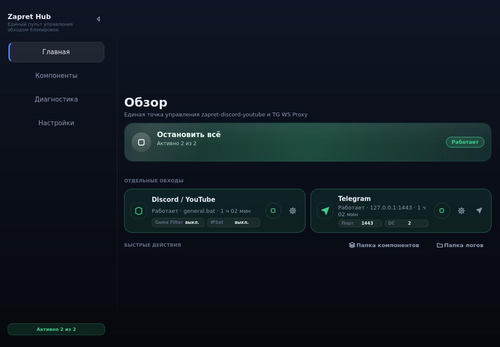

<div align="center">

# Zapret Hub

**Единый пульт управления обходом блокировок**

Один графический интерфейс вместо десятка `.bat`-файлов: запуск, остановка,
настройка, обновление и **автоподбор рабочей стратегии** — из одного окна.


<br>



</div>

---

Единый графический интерфейс (Python + PySide6) для управления
[**zapret-discord-youtube**](https://github.com/Flowseal/zapret-discord-youtube) и
[**TG WS Proxy**](https://github.com/Flowseal/tg-ws-proxy).

Оба «запрета» запускаются **дочерними процессами нашего приложения** — мы знаем их PID,
перехватываем вывод в собственный журнал, корректно останавливаем и настраиваем из одного окна.
Компоненты можно обновлять прямо из программы (GitHub Releases), пользовательские списки
и настройки при обновлении сохраняются.

> [!IMPORTANT]
> **Zapret Hub — только оболочка.** Вся логика обхода блокировок принадлежит авторам
> исходных проектов. Мы не модифицируем их код: стратегии запускаются «как есть»
> (`.bat` → `winws.exe`), TgWsProxy запускается с `--portable`. Своё — только интерфейс,
> управление процессами, автозапуск и сборщик IP по ASN.

| Компонент | Автор | Версия | Источник |
|---|---|---|---|
| zapret-discord-youtube | [Flowseal](https://github.com/Flowseal) | 1.10.3 | github.com/Flowseal/zapret-discord-youtube |
| tg-ws-proxy | [Flowseal](https://github.com/Flowseal) | v1.10.4 | github.com/Flowseal/tg-ws-proxy |
| данные IP по ASN | RIPE NCC | — | stat.ripe.net |

```
Telegram Desktop ──► TG WS Proxy (MTProto, 127.0.0.1:1443) ──► WebSocket ──► Telegram DC
Discord / YouTube ─► winws.exe (WinDivert, стратегия из .bat) ──► обход DPI
```

---

## ✨ Возможности

| | |
|:---|:---|
| 🎛 **Мастер-кнопка** | Одна кнопка запускает и гасит оба запрета сразу. Отдельные карточки — по одному на каждый обход, со плашками ключевых настроек и аптаймом |
| 🔬 **Автоподбор стратегии** | По очереди запускает все `general*.bat`, измеряет HTTP/TLS/ping по 16 целям, ранжирует и **сама применяет лучшую** |
| 🎯 **Свои цели проверки** | Список хостов из `utils/targets.txt` пакета: `Имя = сайт`, `Имя = адрес:порт`, HTTP/1.1, TLS 1.2, TLS 1.3 и ping |
| 📊 **График каждой проверки** | Отдельный столбик на каждый ответ: зелёный — быстро, жёлтый — медленно, **красный — нет ответа** (>10 с) |
| 🧩 **Компоненты как дети** | `winws.exe` и `TgWsProxy` — управляемые дочерние процессы: свои PID, свой журнал, остановка всего дерева |
| 🧹 **Обходы переживают закрытие** | Закрыли окно или сняли задачу в диспетчере — `winws.exe` и `TgWsProxy` продолжают работать. Гаснут сами только при обновлении и удалении программы; прежнее поведение возвращает галочка «Останавливать обходы при выходе» |
| ⬇️ **Обновления из GUI** | Проверка версий на GitHub Releases, скачивание, бэкап, сохранение пользовательских списков |
| 🌐 **Сборщик IP по ASN** | ~90 автономных систем через RIPE Stat → `lists/ipset-all.txt`, с прогрессом и возможностью остановить |
| 🔔 **Тосты** | Уведомления стеком, не больше трёх одновременно, без крестика — закрываются любым кликом |
| 🖥 **Трей + автозапуск** | Свёрнутый режим с параметром `--tray`, запись в `HKCU\...\Run`, иконка **вшита в exe** |
| 🌍 **RU / EN** | Переключение языка интерфейса на лету, в настройках |
| 🎨 **Тёмная тема** | Единая палитра, стеклянные кнопки, векторные иконки — без эмодзи |

---

## 🚀 Установка и запуск

### Из исходников

Нужен Python 3.10+ (проверено на 3.11/3.13).

```bat
git clone https://github.com/kudasai012/ZapretHub.git
cd ZapretHub
run.bat
```

`run.bat` — самый простой способ: сам находит Python (`py` → `python`), при
необходимости доставляет зависимости из `requirements.txt`, выбирает оконный
интерпретатор (`pyw` → `pythonw` → `python`) и запускает `run.pyw` без консоли.
Если Python не найден — печатает понятную подсказку вместо молчания.
Файл намеренно содержит только ASCII: кириллица в `.bat` ломает разбор cmd.exe.

Вручную:

```bat
pip install -r requirements.txt
python run.pyw
```

`run.pyw` — запуск без консольного окна (можно двойным щелчком).

---

## 📁 Где программа хранит данные

При запуске из исходников (`python run.pyw`) всё изменяемое лежит в папке
проекта — удобно смотреть и править руками.

| Что | Где |
|---|---|
| `data/config.json` | настройки программы (выбор языка, стратегия, тема) |
| `data/components.json` | какие компоненты установлены и какой версии |
| `data/logs/hub.log` | журнал работы |
| `data/backups/` | копии перед обновлением компонентов |
| `data/tmp/` | временные файлы при скачивании |

Точные пути показывает **Настройки → Расположение** (там же кнопка «Открыть папку»).

---

## 🔬 Диагностика

Страница «Диагностика» — то, ради которого стоит попробовать Hub. Она повторяет
проверки `service.bat`, но наглядно и со статистикой:

1. **Цели** берутся из `utils/targets.txt` пакета zapret: `Имя = https://сайт`
   (проверяем HTTP/1.1, TLS 1.2, TLS 1.3), `Имя = адрес:порт` (проверяем ping).
   Список **только для чтения** — им владеет пакет, приложение лишь восстанавливает его.
2. **Каждую цель проверяем тремя протоколами отдельно**, поэтому в строке видно
   `HTTP/1.1 12/12 · TLS 1.2 12/12 · TLS 1.3 12/12 · ping 16/16`.
3. **Каждый ответ — столбик в графике**: зелёный (быстрее 400 мс), жёлтый
   (медленнее 400 мс), **красный — нет ответа**. Каждая цель получает 10 секунд:
   если сайт молчит, оставшиеся попытки помечаются как неуспешные и прогон не подвешивает.
4. **Успешность считается в процентах** — на неё можно опираться, сравнивая стратегии.
5. **Выбираете, что тестировать** — галочки у строк, «отметить все» / «снять все»
   в шапке списка. В шапке видно, сколько стратегий пойдёт в прогон.
6. **Лучшая поднимается наверх** и обводится голубой рамкой; после прогона
   она **автоматически становится текущей** — даже если прогон остановили вручную.
7. Клик по строке раскрывает её журнал: каждый замер, какой сайт не ответил,
   какая попытка не уложилась в бюджет.

---

## 🏗 Структура проекта

```
Zapret_hub/
├── run.pyw                 точка входа (без консоли)
├── requirements.txt
├── assets/                 иконка приложения (icon.ico 16…256, icon.png 1024,
│                          icon_candidate.png — исходник для пересборки)
├── docs/
│   └── f_home.png          скриншот для README
├── app/
│   ├── main.py             запуск, single-instance, автозапуск, elevation
│   ├── context.py          конфиг + компоненты + апдейтер
│   ├── config.py           data/config.json (настройки)
│   ├── paths.py            пути: BASE_DIR (программа) и DATA_ROOT (данные)
│   ├── assets.qrc          описание ресурса Qt (вшитая иконка)
│   ├── resources_rc.py     сгенерирован rcc из assets.qrc — в коммите
│   ├── i18n.py             локализация RU/EN
│   ├── core/
│   │   ├── win32.py        админ-права, реестр, taskkill, службы, netsh
│   │   ├── procman.py      ManagedProcess: stdout/stderr → журнал, остановка дерева
│   │   ├── zapret.py       разбор .bat-стратегий, Game Filter, IPSet, user-списки
│   │   ├── tgws.py         портативный конфиг TgWsProxy, ссылка, хвост proxy.log
│   │   ├── github.py       GitHub Releases API
│   │   ├── netutil.py      HTTP-запросы и скачивание (с прокси)
│   │   ├── asn.py          сбор IP заблокированных провайдеров по ASN (RIPE Stat)
│   │   ├── strategy_test.py автоподбор стратегий: HTTP/TLS/ping-замеры в потоке
│   │   ├── probe.py         HEAD-запрос с заданной версией TLS и ping
│   │   └── updater.py      установка/обновление, бэкапы, сохранение настроек
│   └── ui/
│       ├── main_window.py  панель окна, боковое меню, кроссфейд страниц
│       ├── update_dialog.py диалог проверки и установки обновлений
│       ├── tray.py         иконка в трее
│       ├── app_icon.py     единственное место, откуда берётся иконка
│       ├── icons.py        векторные иконки (рисуются QPainter)
│       ├── anim.py         кроссфейд, появление, пульс, тосты
│       ├── theme.py        единая тёмная тема (QSS)
│       ├── widgets.py      MasterButton, StatusRow, StatusDot, StatusPill,
│       │                   LogView, Banner, FormRow, Toast
│       └── pages/
│           ├── base.py           страница с прокруткой
│           ├── home.py           главная: общая кнопка + статусы
│           ├── components.py     страница «Компоненты»
│           ├── diagnostics.py    автоподбор стратегии (HTTP/TLS/ping-тесты всех general*.bat)
│           ├── component_panel.py база панели компонента
│           ├── zapret_panel.py   настройки zapret
│           ├── tgws_panel.py     настройки TG WS Proxy
│           └── settings_page.py  настройки и автозапуск
├── components/             скачанные компоненты (создаётся автоматически, в релиз не входит)
└── data/                   config.json, components.json, logs/, backups/, tmp/
                           (в установленной версии — %LOCALAPPDATA%\Zapret Hub)
```

---

## ⚙️ Что где настраивается

**Zapret**

* `Стратегия` → `data/config.json` → `zapret.strategy`, при запуске преобразуется в аргументы `winws.exe`
* `Game Filter` → `components/zapret-discord-youtube/utils/game_filter.enabled`
* `IPSet` → `components/zapret-discord-youtube/lists/ipset-all.txt` (+ `.backup`)
* `Пользовательские списки` → `lists/list-general-user.txt`, `lists/list-exclude-user.txt`, `lists/ipset-exclude-user.txt`
* `Обновить список IP` — качает `.service/ipset-service.txt` из репозитория Flowseal

**TG WS Proxy**

* Всё пишется в портативный `components/tg-ws-proxy/TgWsProxy_data/config.json`
  (приложение запускается с `--portable`, поэтому настройки и логи лежат рядом с ним)
* Лог компонента: `TgWsProxy_data/proxy.log` — его хвост показывается в нашем журнале
* Ссылка для Telegram: `tg://proxy?server=…&port=…&secret=dd…`

---

## 🛠 Полезные команды

```bat
python run.pyw --tray        свернуться в трей и запустить компоненты (как автозапуск)
python run.pyw --minimized   стартовать свёрнутым
python -m app                альтернативный запуск
python run.bat debug          запуск с консолью — видны все ошибки
python tools/smoke_test.py       дымовой тест UI и парсера стратегий
python tools/shutdown_test.py    проверка: выход не гасит обходы, установщик — гасит
python tools/procman_test.py     проверка: обход переживает смерть программы
python tools/integration_test.py установка/обновление zapret с реального GitHub
python tools/screenshots.py      скриншоты интерфейса (offscreen)
python tools/make_icon.py        пересобрать assets/icon.{png,ico} из исходника
python tools/fetch_components.py  скачать/обновить компоненты без GUI
python tools/make_readme_shots.py   переснять docs/f_home.png для README
python tools/preview_readme.py       посмотреть README в браузере (без интернета)
```

---

## ⚠️ Замечания

* Zapret (`winws.exe`) работает только в Windows и требует прав администратора;
  программа сама предложит перезапуск с повышением прав.
* Если стоит служба Windows `zapret` (её ставит `service.bat`), Hub предупредит и
  предложит удалить её — иначе `winws.exe` не сможет запуститься.
* `TgWsProxy_windows.exe` — Windows-сборка; на Linux/macOS приложение запустится,
  но компоненты будут недоступны (статус «Остановлен»).
* Если GitHub недоступен, в настройках обновлений можно указать прокси
  (`http://127.0.0.1:2080`, `socks5://127.0.0.1:1080`).
* Колесо мыши не меняет значения в списках и числовых полях — только клик и стрелки.

---

## 📄 Лицензии

* **zapret-discord-youtube** — MIT, © Flowseal
* **tg-ws-proxy** — MIT, © Flowseal

Оболочка Zapret Hub распространяется как есть; ответственность за использование
несёт пользователь.

---

<div align="center">
<sub>Сделано на Python + PySide6 · Иконки рисуются кодом, тёмная тема одна на все страницы</sub>
</div>
